# M2 actual candidate previews

Source candidate: `fe804e34b1ad43244ec1ac8401c9576079244e3b`. Base: `eaeb7b942b882685a97786e66df7fd91fd3b9dec`.

Open [the standalone HTML](Alice-V2-M2-preview.html) after downloading it, or use the loopback source route documented in [README](README.md). The HTML was tested directly from disk, with no server, network requests or browser errors. Select a preferred name, then the unchanged classic Home appears. Choose **Entrar na demonstração Alice V2** to enter. **Sair da demonstração** returns to Home. Reload turns V2 off and resets demo teams/conversations; classic browser fixtures reset independently of native preferences.

Captured from this exact candidate using isolated Chrome 154.0.8037.98 headless, fresh synthetic context, no personal browser, real account or worker. These are actual frontend screenshots, not native Windows application captures. Images are unedited. Large ASCII Home animation is the existing implementation; PNGs capture a frame. Original and Cream & Rose are existing theme tokens. Activity shows recorded pure M1 execution, not live agent activity. Team saves are in-memory only.

## 01-home-original.png

Original classic Home after preferred-name onboarding; large animated ASCII A. Only the demo preview adds an opt-in entry button. Viewport 1600×1000; theme `elite-indigo`; source `fe804e34b1ad43244ec1ac8401c9576079244e3b`.

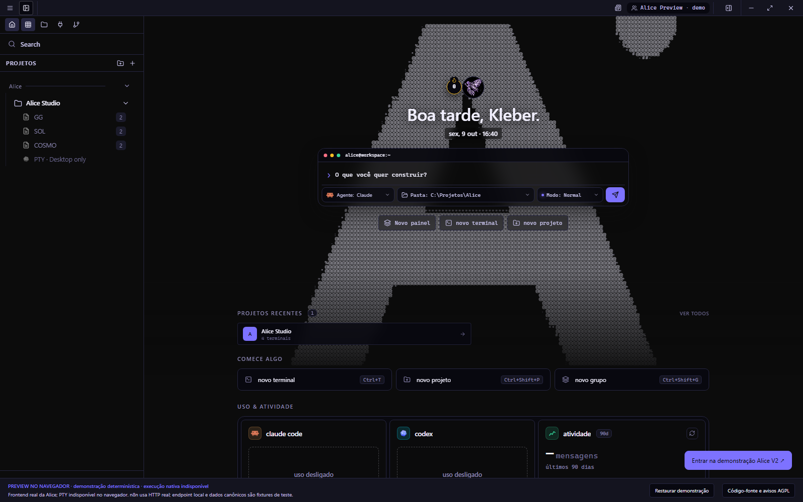

## 02-gg-chat.png

One GG conversation, local sample responses, and fake-only team overview. Viewport 1600×1000; theme `elite-indigo`; source `fe804e34b1ad43244ec1ac8401c9576079244e3b`.

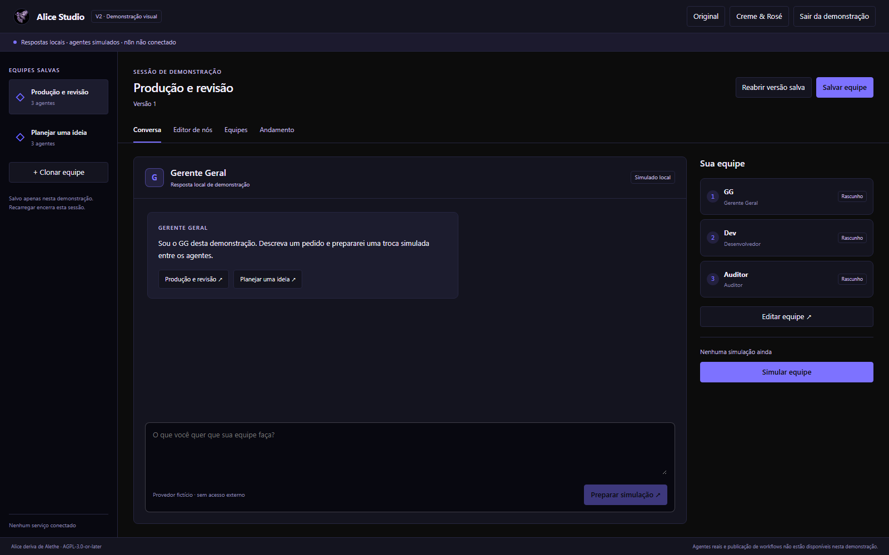

## 03-chat-approval.png

User request and local GG response; M1 waits for explicit fake-only approval. Viewport 1600×1000; theme `elite-indigo`; source `fe804e34b1ad43244ec1ac8401c9576079244e3b`.

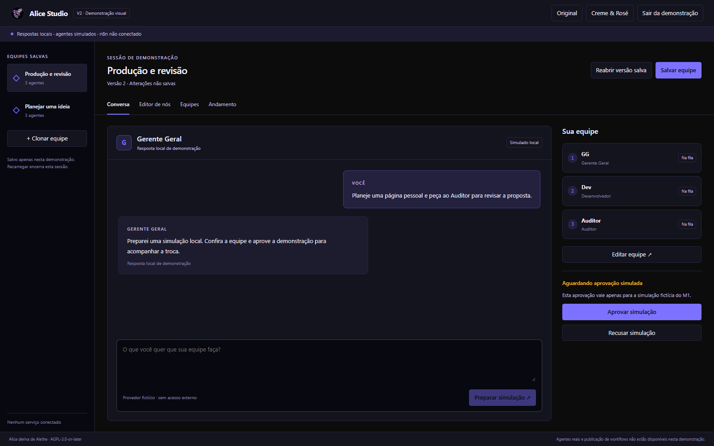

## 04-node-editor.png

Editable GG, Dev, Auditor canvas with scoped inspector; pure M1 graph. Viewport 1600×1000; theme `elite-indigo`; source `fe804e34b1ad43244ec1ac8401c9576079244e3b`.

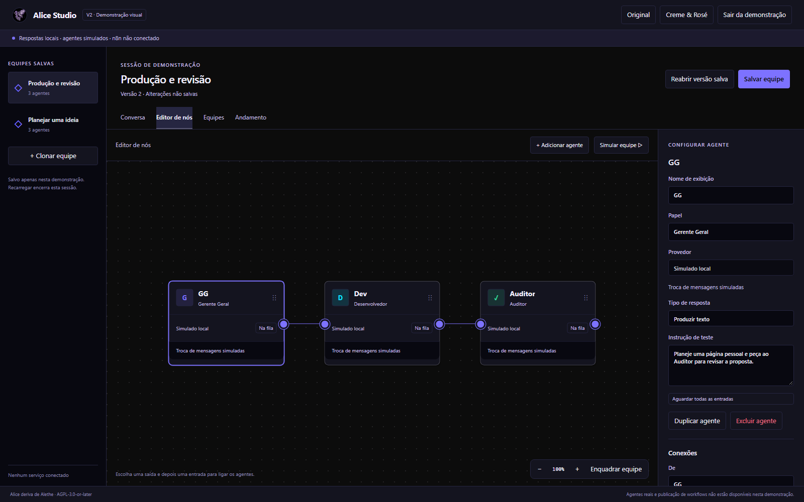

## 05-inspector.png

Renamed Dev, dragged node and saved canvas layout; fake provider is fixed. Viewport 1600×1000; theme `elite-indigo`; source `fe804e34b1ad43244ec1ac8401c9576079244e3b`.

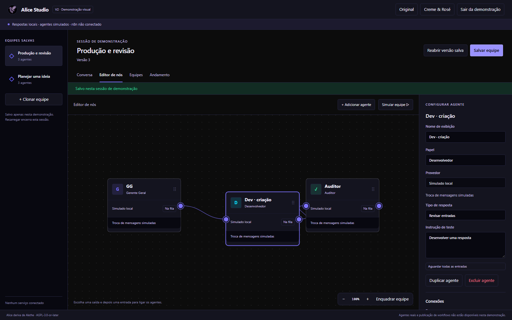

## 06-cycle-rejected.png

M1 rejects Auditor → GG cycle without replacing the valid graph. Viewport 1600×1000; theme `elite-indigo`; source `fe804e34b1ad43244ec1ac8401c9576079244e3b`.

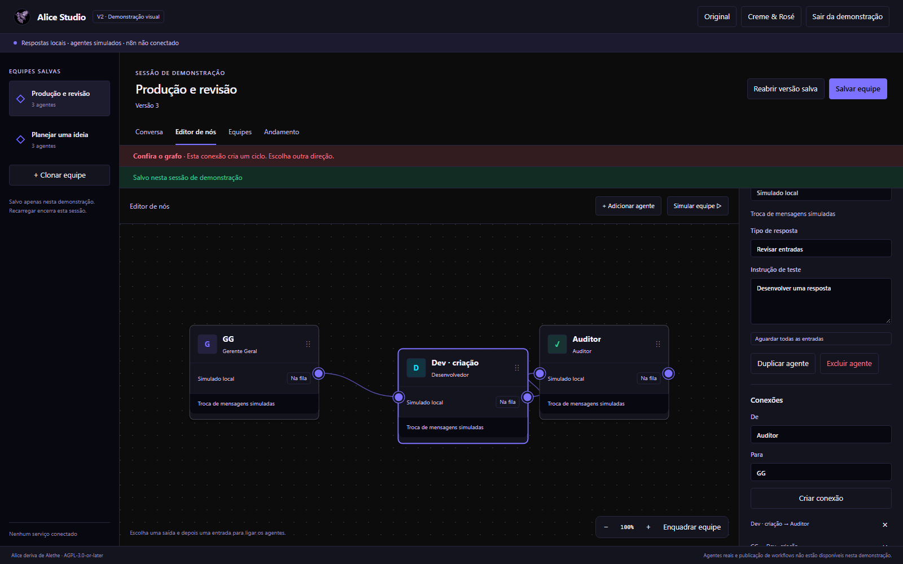

## 07-teams.png

Two presets and a cloned configuration; saving is explicitly limited to the current demo session. Viewport 1600×1000; theme `elite-indigo`; source `fe804e34b1ad43244ec1ac8401c9576079244e3b`.

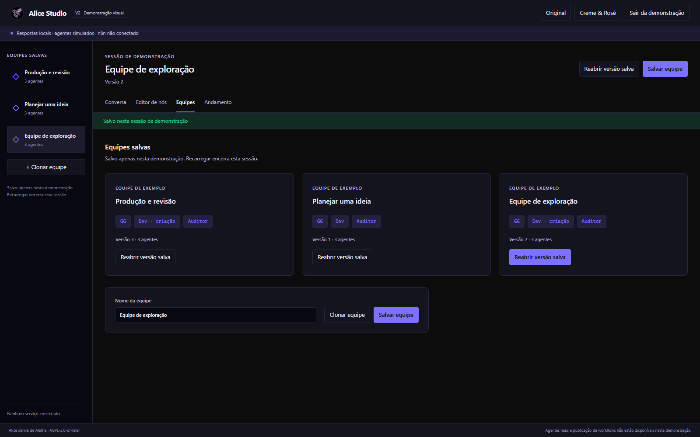

## 08-running-replay.png

In-flight states replay real captured M1 events; no worker or n8n is live. Viewport 1600×1000; theme `elite-indigo`; source `fe804e34b1ad43244ec1ac8401c9576079244e3b`.

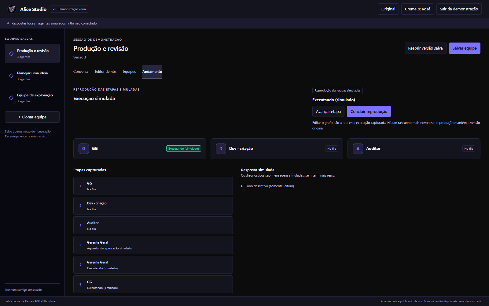

## 09-completed-replay.png

Completed playback and actual local deterministic M1 receipts. Viewport 1600×1000; theme `elite-indigo`; source `fe804e34b1ad43244ec1ac8401c9576079244e3b`.

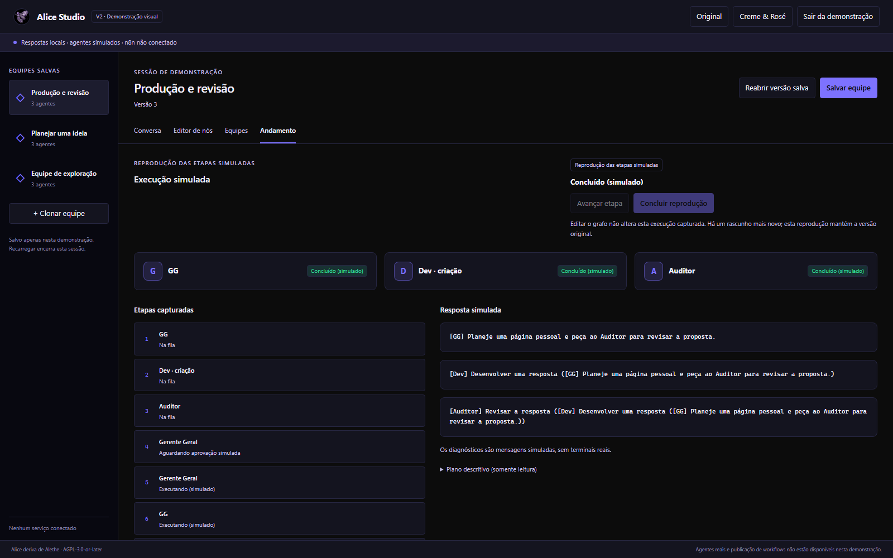

## 10-editor-cream-rose.png

Same M2 editor uses existing Cream & Rose theme tokens, without theme-file edits. Viewport 1600×1000; theme `cream-rose`; source `fe804e34b1ad43244ec1ac8401c9576079244e3b`.

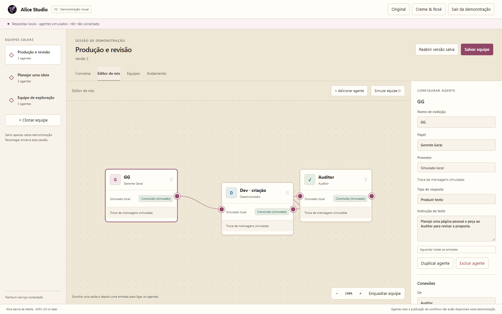

## 11-chat-cream-rose.png

GG conversation under existing Cream & Rose tokens. Viewport 1600×1000; theme `cream-rose`; source `fe804e34b1ad43244ec1ac8401c9576079244e3b`.

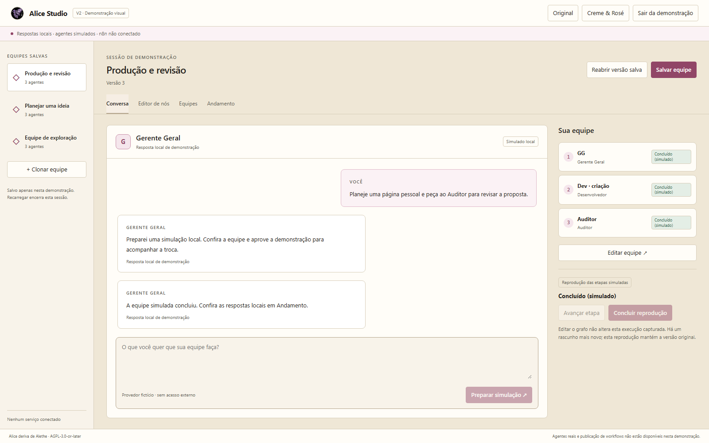

## 12-editor-narrow.png

850px responsive canvas with inspector below; scrollable document. Viewport 850×1000; theme `cream-rose`; source `fe804e34b1ad43244ec1ac8401c9576079244e3b`.

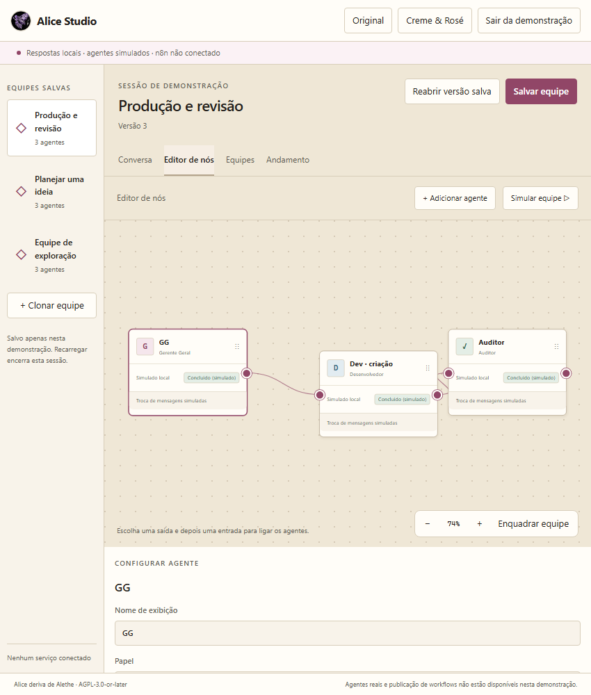

## 13-return-home.png

Leaving the demo returns directly to the same classic Home and ASCII animation. Viewport 1600×1000; theme `elite-indigo`; source `fe804e34b1ad43244ec1ac8401c9576079244e3b`.

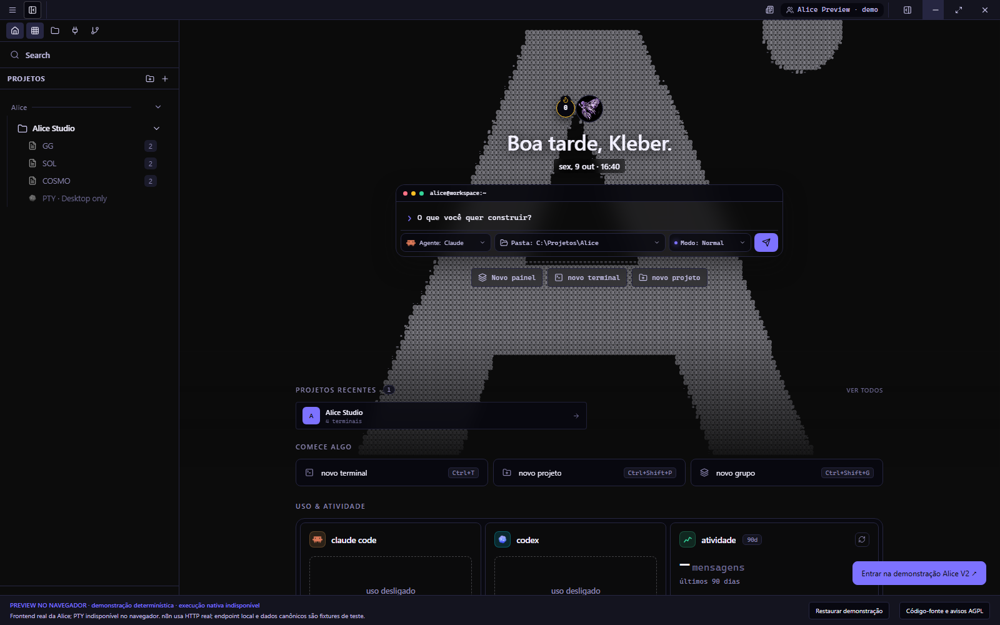

## Standalone HTML verification

1600×1000, Original, source `fe804e34b1ad43244ec1ac8401c9576079244e3b`; Chrome opened the self-contained HTML directly from disk and successfully approved and completed a fake M1 simulation.

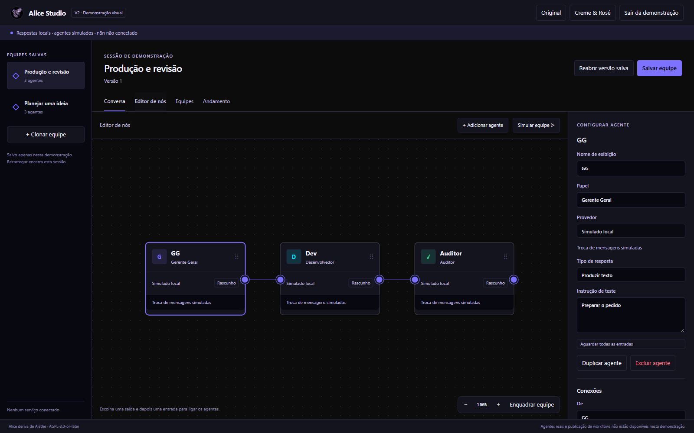

See [browser evidence](browser-results.json), [standalone checks](portable-results.json), [validation](validation.json), and [SHA-256 inventory](HASHES.json). Visual approval is pending; these are producer checks, not independent QA.
