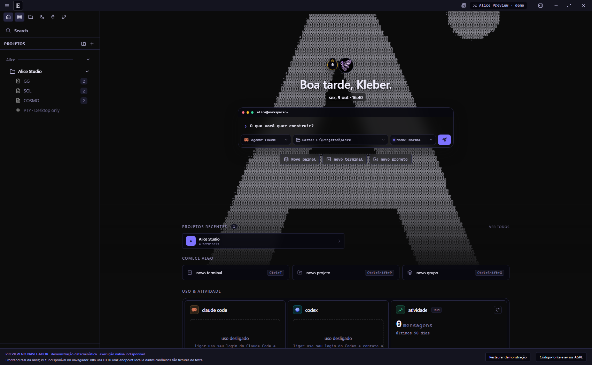
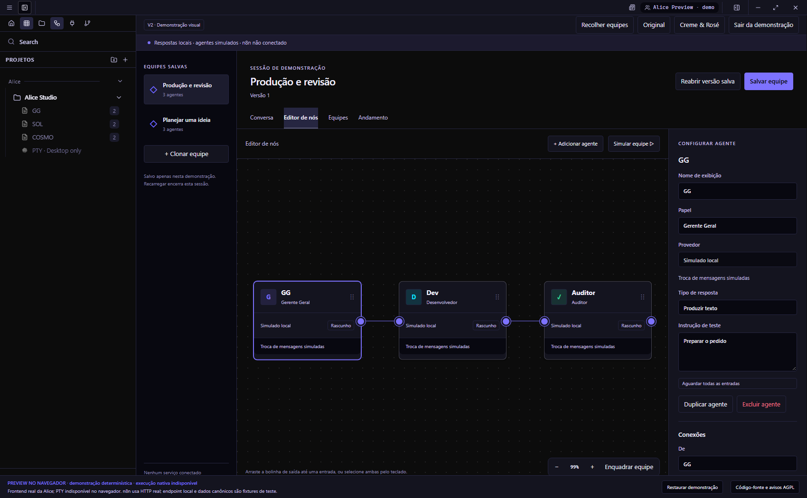
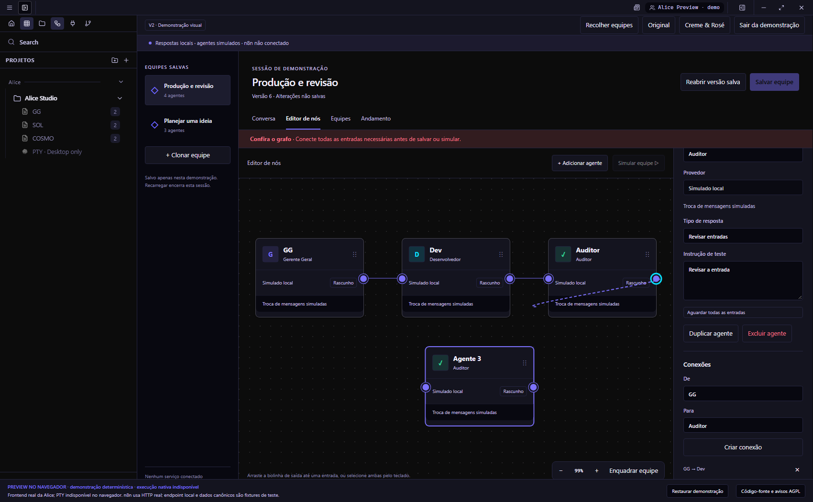
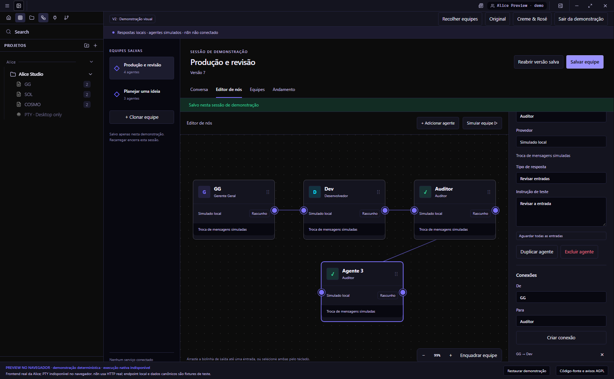
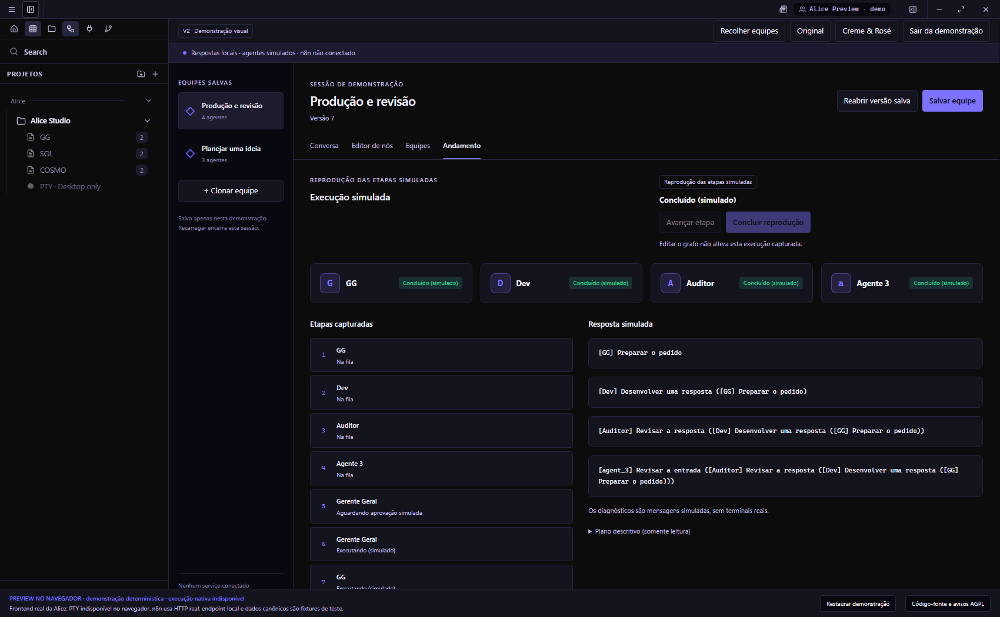
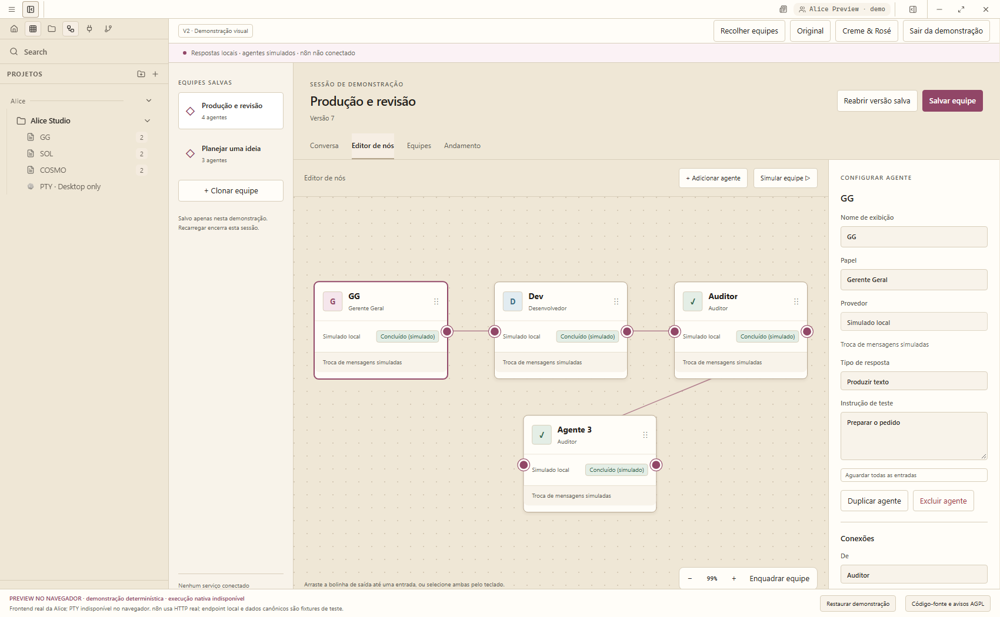
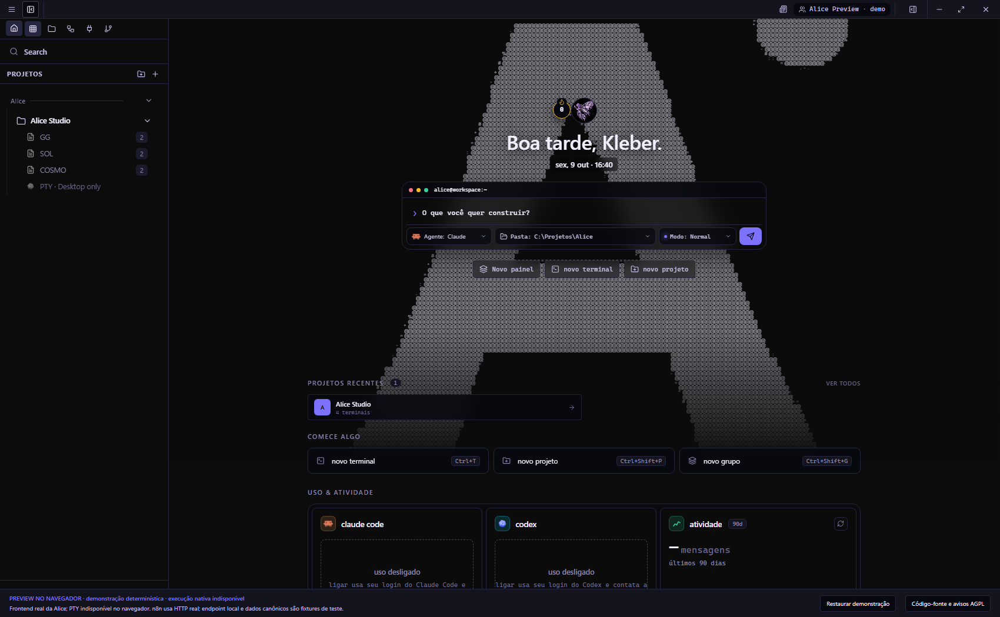
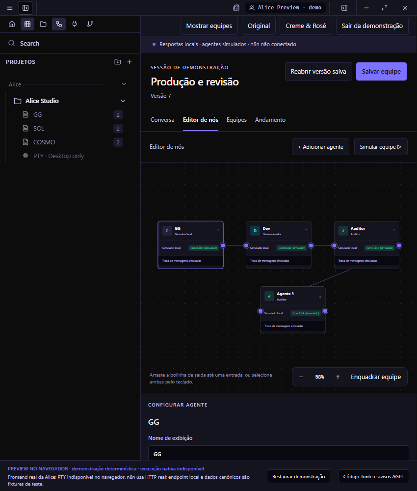
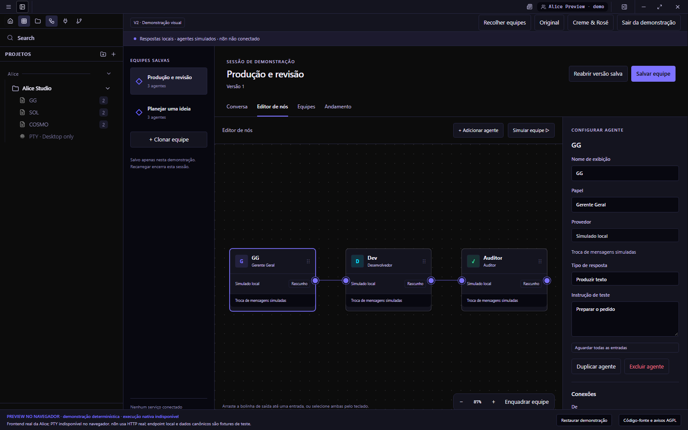

# Actual sidebar / drag previews

Source `b85fa553a16e61d372140496c4636a9556594c66`; branch `codex/alice-v2-sidebar-drag`; base published R251 `bdabac7e63478f41400e71868ef95bfb2e281ab4`. This is the direct owner-authorized follow-up; the GG held its duplicate R252 task.

Download [standalone HTML](Alice-sidebar-drag-preview.html), open it locally, select a preferred name, and click **Agentes e ligações** in the original left icon rail. Home remains default. Drag an output circle to an input; release finishes a validated connection. Use the existing Home icon to return. Original / Cream & Rose and session-only teams remain available.

Actual unedited isolated Chrome 154.0.8037.98 screenshots; synthetic data, fixed date, browser frontend, not native Windows. No real worker or n8n. Pending wires shown during a real pointer drag; activity is recorded deterministic M1 playback. The portable HTML was tested without a server.

## 01-home-sidebar.png

Original personalized ASCII Home with Alice V2 entry in the persistent left sidebar; no floating launcher. 1700×1050, theme `elite-indigo`, source `b85fa553a16e61d372140496c4636a9556594c66`.

## 02-integrated-editor.png

V2 editor embedded in original Alice shell and sidebar. 1700×1050, theme `elite-indigo`, source `b85fa553a16e61d372140496c4636a9556594c66`.

## 03-drag-line.png

Actual pending connection line follows the cursor from the output circle. 1700×1050, theme `elite-indigo`, source `b85fa553a16e61d372140496c4636a9556594c66`.

## 04-manual-connected.png

Four agents connected by direct port dragging; full M1 validation now permits save and simulated execution. 1700×1050, theme `elite-indigo`, source `b85fa553a16e61d372140496c4636a9556594c66`.

## 05-simulated-complete.png

Actual deterministic four-agent M1 playback completed; no real agents or n8n. 1700×1050, theme `elite-indigo`, source `b85fa553a16e61d372140496c4636a9556594c66`.

## 06-integrated-cream.png

Integrated sidebar/editor uses the existing Cream & Rose theme. 1700×1050, theme `cream-rose`, source `b85fa553a16e61d372140496c4636a9556594c66`.

## 07-return-home.png

Original Home icon returns to unchanged personalized Home and ASCII A. 1700×1050, theme `elite-indigo`, source `b85fa553a16e61d372140496c4636a9556594c66`.

## 08-narrow-editor.png

850px view with teams collapsed and inspector scrollable below canvas. 850×1000, theme `elite-indigo`, source `b85fa553a16e61d372140496c4636a9556594c66`.

## Standalone editor

1600×1000, Original, source `b85fa553a16e61d372140496c4636a9556594c66`. Actual HTML opened from disk.

[Validation](validation.json) · [Protection audit](preservation.json) · [SHA-256](HASHES.json).
