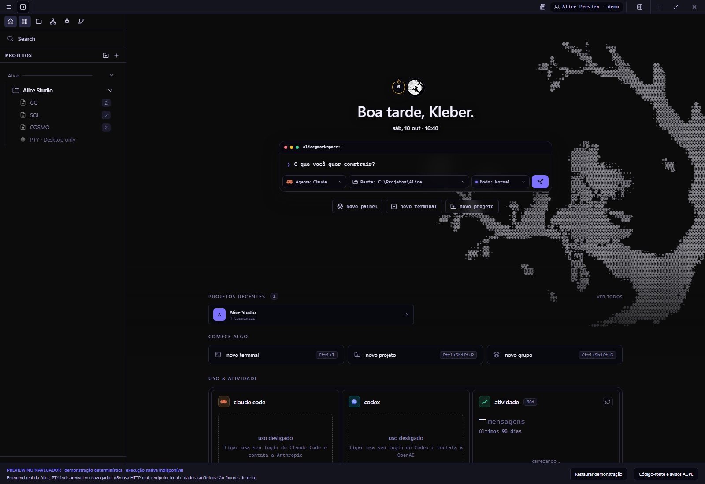
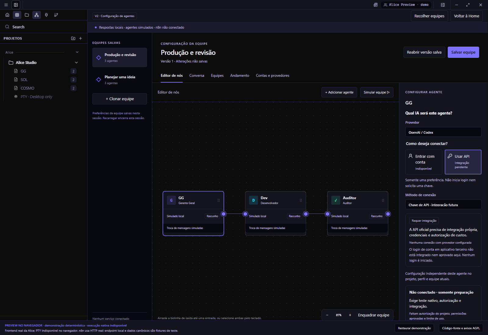
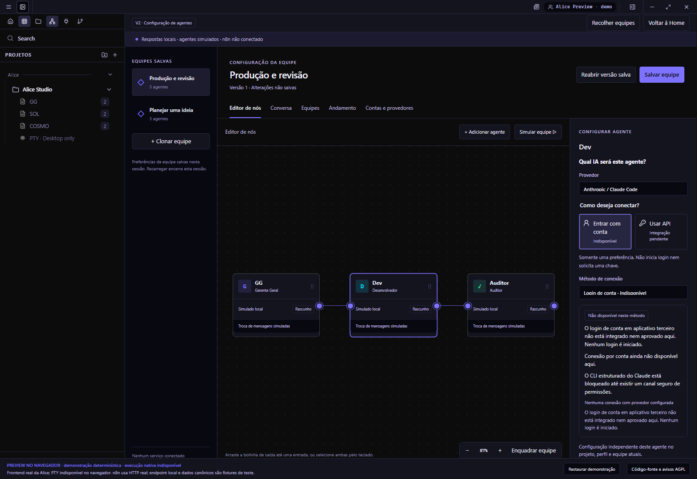
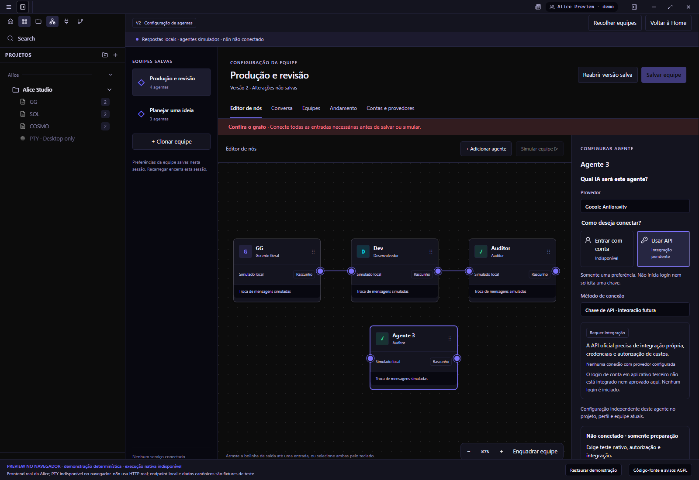
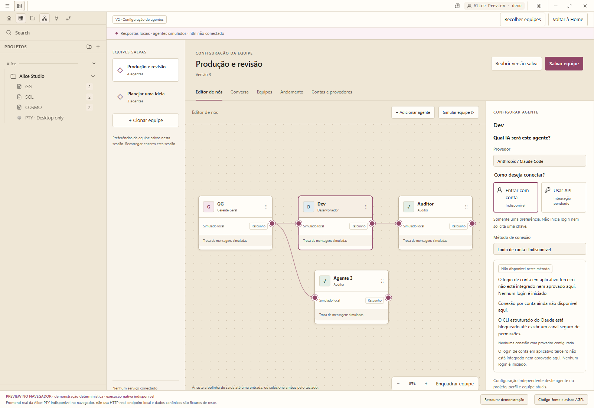
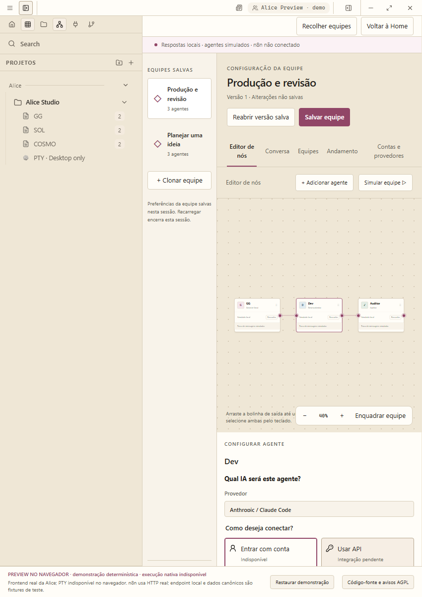
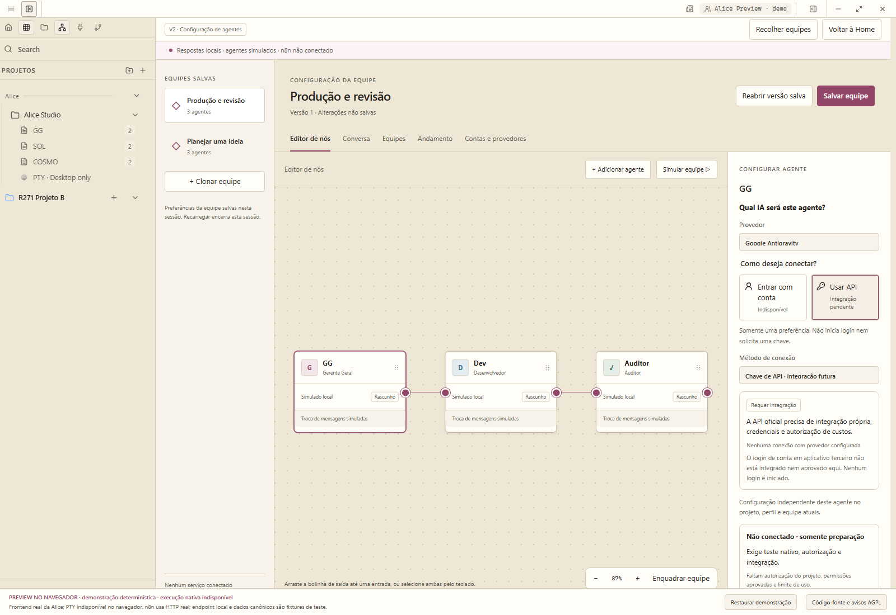
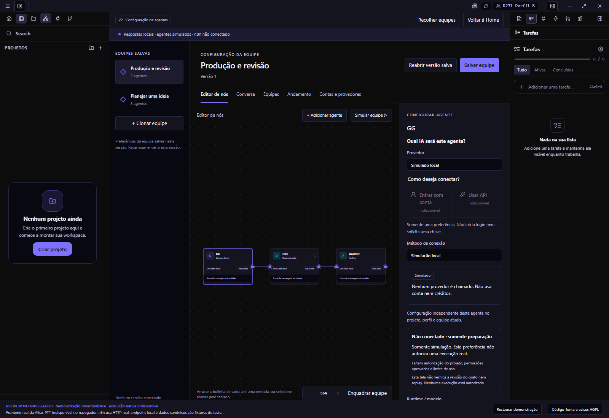
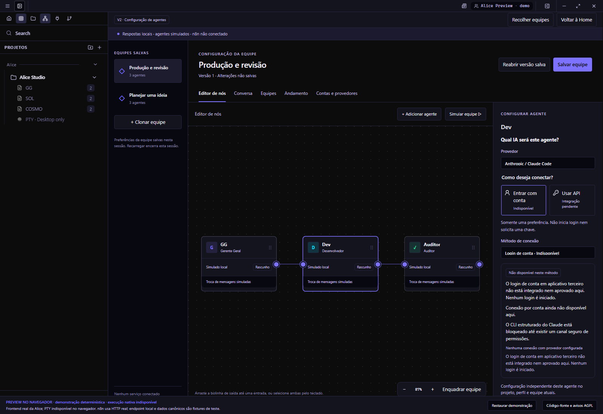

# Actual Alice App R271 previews

Source **7c61693a0345252996a7f4f6ed673e639ce14fb0**, actual local full App in isolated Chrome 154.0.8037.98, PT-BR, synthetic workspace/profile metadata. Root App/Home/Accounts/theme/art are unchanged. Pixel captures, not generated mockups.

[Open the actual local App](http://127.0.0.1:1448/docs/alice/v2/m3g/Alice-browser.html) · See OPEN_IN_BROWSER.md for one-command reopening/stop and same-App offline file.

## Existing Alice full App Home before entering Agents & connections.

Viewport: 1600×1100; theme: elite-indigo; SHA-256: 81871a9734951de3319487970e19b675f02d6a19a36d24347936fabd27d0751c

## GG OpenAI/Codex + Use API in the actual App inspector; integration pending, no key requested.

Viewport: 1600×1100; theme: elite-indigo; SHA-256: df2e9fa68d34ffc70c1f40f6e96ca83b712aa2ce14b76011060052515a4991e7

## Dev Anthropic/Claude account preference selected; account connection unavailable, no login started.

Viewport: 1600×1100; theme: elite-indigo; SHA-256: a9ace41a02092f9b7f81e8f2d534c525c7adb545815024ab95aa73f3857b8a1d

## New logical worker uses the existing Google Antigravity provider option with API preference only.

Viewport: 1600×1100; theme: elite-indigo; SHA-256: ede799f69ddfea0e3969d64d8b54af1b1c30a50571789ff14a23a5c765824e41

## The same existing App/editor and account preference in the preserved Cream & Rose theme.

Viewport: 1600×1100; theme: cream-rose; SHA-256: 21334096728febe41c22ea1079763359bed7333dc692b3e40dff501330493c5f

## Actual 850px App, scrolled to the existing inspector so both company and account/API choices are fully visible.

Viewport: 850×1200; theme: cream-rose; SHA-256: f8949e522c4f5fab17858c13db5151a18ad605d307b556cb6f8012bfe29dba4e

## Existing project creation/navigation scopes an independent GG preference in project B; terminal dialog cancelled without launching anything.

Viewport: 1600×1100; theme: cream-rose; SHA-256: d269a3f46dbe587d2e65a0a25b5803618f88d9472844f0096f5b8048d52ea60c

## Actual existing local-profile UI switches to an independent agent configuration; no account/provider login.

Viewport: 1600×1100; theme: elite-indigo; SHA-256: eba1a413855cfe40bf34e32bd19fb78fb79881dba04cda8bca556a7073d21944

## The same bundled full Alice App running from file://, with actual account/API inspector.

Viewport: 1600×1100; theme: elite-indigo; SHA-256: 0885e7bcc76b685bae97262680d8cb5d4bc3f1d8c9e24be9ac0dc2e649a28ba4

All screenshots come from real clicks on the regular App or its actual bundled offline export. No alternative renderer/editor or injected UI store. Final owner visual approval and independent native QA are not claimed.
